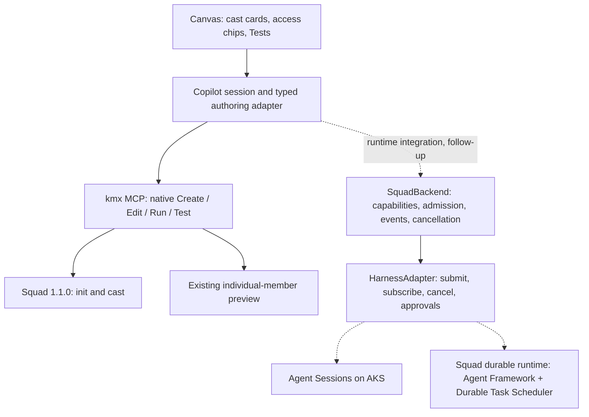

# Squad canvas: demo and architecture

The first vertical slice uses real native Squad 1.1.0 authoring through kmx MCP:
review a proposal, Create once, reopen the team, save the shared brief, edit a
member and run its tests. With a Copilot-configured backend, the field-service
example uses the catalog's real default model and a JSON output contract. With a
fake-configured backend it retains the deterministic orientation example.
The initial missing conflict-strategy check is intentional in both examples.

New to Squad? Read [the illustrated code-flow guide](SQUAD-CODE-FLOW.md) for the
concepts, source ownership and function-by-function creation/edit/test walkthrough.

## Architecture after maintainer feedback



The upstream experimental interfaces are defined in
[Squad backend/types.ts](https://github.com/bradygaster/squad/blob/b1fc9a2767993fcbcba51cade077c47a58278700/packages/squad-sdk/src/backend/types.ts).
The canvas's native authoring projection is not an implementation of that
conversation API. Integrate the real contract rather than inventing a matching
name for the existing preview operations. Runtime-specific logic stays out of
the renderer. Negotiated capabilities control available actions; access chips
must describe actual host enforcement. The current chip describes tool-free
native previews, which kmx enforces.

Tests are the quick inner-loop checks. Waza is the deeper package-digest evaluation
integration. Later recovery must distinguish journal replay from uncertain tool
or sandbox calls requiring fencing/approval; never replay an uncertain Create.

## Open in Copilot

Package a development plugin with a current kmx binary and a qualified standalone
Squad 1.1.0 launcher using `package.py` as described in [README.md](README.md).
Install that generated directory, open its configured demo project in the Copilot
app, and invoke `/squad-view`. The canvas can also be opened through the built-in
opener with `canvasId: kmx-squad-view`, provider
`plugin:kmx-agent-builder:agent-view`, stable instance ID `kmx-squad`, and input `{}`.

For a chat-generated proposal, the opener accepts `input.proposal` with `brief`,
`lead` and `specialists`. Every member contains `memberId`, `role`, `displayRole`,
`taskInstructions`, `model` and `tests` (the existing ID/input/assertions objects).
The Lead uses role `lead` and display role `Lead / Architect`. Opening has no
creation effects. The canvas validates and submits only on Create squad.

## Browser rehearsal with real MCP

```sh
node plugins/tests/copilot/squad-demo.mjs /absolute/kmx /absolute/demo-root /absolute/squad
```

Add `copilot` as the final argument for real hosted-model previews. The installed
recording bundle must likewise have explicit `--provider copilot` in its native
MCP startup arguments and an existing GitHub sign-in. The helper forwards real
native progress notifications and connection-scoped cancellation; it never
implements model execution itself.

This checkout helper forwards JSON-RPC to the real engine and displays its URL.
It supplies neither a fake MCP server nor a second preview runner. Browser
rehearsal is supplementary to the issue's required real Copilot-app screenshot.

### Five-minute demo

If the team already exists in the configured project, start at step 4 with the
saved team. Create does not replace an existing roster or reset the demo.

1. Open the Squad canvas and choose **Use field-service app example**.
2. Expand a card, show its persona, model and inline starter tests. Rename a
   proposed specialist role or remove a proposed card.
3. Click **Create squad**. Show per-member native authoring outcomes.
4. Open **Offline storage** and press Enter. Its conflict test should fail.
5. For the real-model example, replace the prompt with `STORAGE_FIXED_PROMPT`
   from `squad-examples.mjs`: it requires three string-valued JSON keys and sets
   conflictStrategy to the exact value `preserve-both`. Keep the test unchanged.
   For the fake orientation only, change its prompt to `Reply with exactly` followed by a backtick-quoted
   `Queue writes locally; synchronize on reconnect; preserve both edits.` and a
   final period. Press Enter again to show the fixed full-member result.
6. Open one test and run it alone. Explain that a selected pass remains partial.
7. Return to Squad, update/save the shared brief, and reopen a member to show its
   previous result is stale. Refresh/reopen the team from native state.

While a real test is running, show the case counts, then type a new prompt edit
or click Stop tests. The old invocation is cancelled without aborting chat;
completed rows remain partial and the new draft survives. Enter after it stops
explicitly starts the next save/test. A test awaiting approval in Copilot chat
shows that state; it is not yet cancellable through the native active-run control.

For a chat-generated team, use Ask Copilot to propose instead of the preset.
The response returns to the same canvas as a reviewable offer. Use suggested team
accepts it; Keep my draft preserves current work. Suggest changes follows the same
review flow, with no native writes until Create squad.

The shared brief is saved in `.squad/kmx-brief.md` using revision-checked source
publication. Preview envelopes carry both member and brief revisions. Fake
orientation consumes its task-only directive; real model routes receive native
instructions plus the shared brief. Fake results do not prove semantic use of
the brief or real-model quality.

## Remaining work

The native authoring adapter now supports real-model examples, per-case progress
and request-scoped Test cancellation. Actual SquadBackend/HarnessAdapter runtime
integration, retained history and Waza integration remain follow-up work. Before
shipping, complete real app visual approval and broader cross-platform/security
qualification. Existing successful native creation can have partial brief-save
effects; inspect them, never repeat Create automatically.
